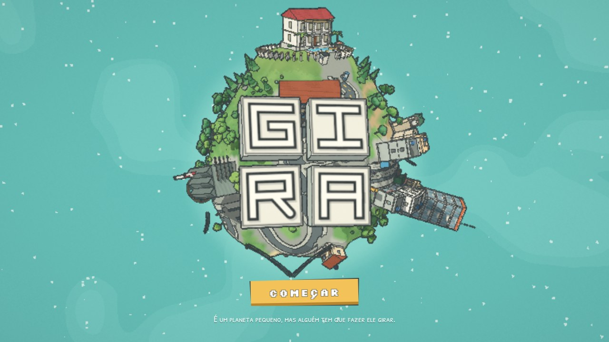
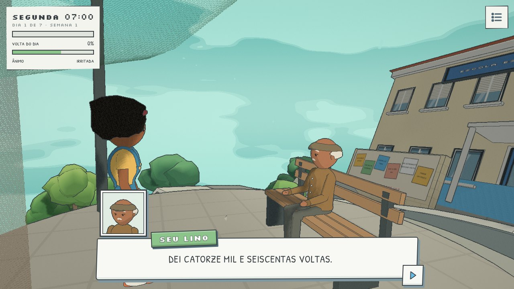
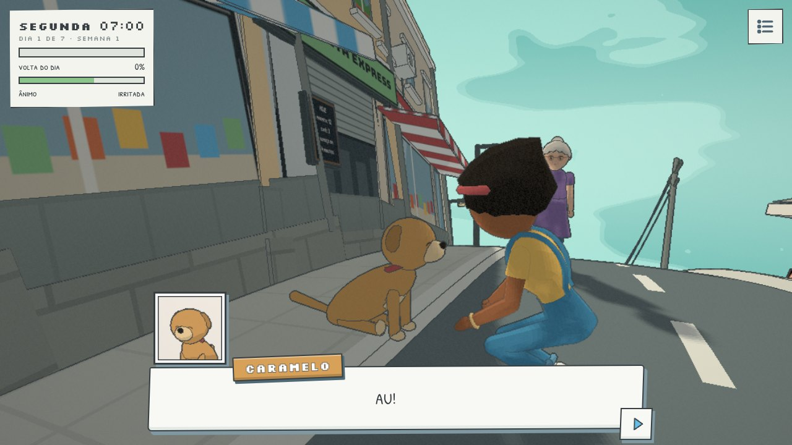

# GIRA

**É um planeta pequeno, mas alguém tem que fazer ele girar.**

GIRA é um joguinho de navegador sobre um planeta minúsculo que só gira quando você anda. Cada volta completa é um dia de trabalho, o chefe sempre quer mais uma volta, e a semana tem seis dias de expediente para um domingo que nunca chega. É uma crítica bem-humorada à escala 6x1, à rotina que anda em círculos e ao cansaço de quem mantém tudo funcionando.



## O jogo

- **O mundo só se move se você se mover.** Andando, o planeta gira, o relógio corre e a barra do dia enche. Parou, o sol para também.
- **14 bairros para explorar**, espalhados pelo planeta inteiro: Praça do Relógio, a sede da GIRA S.A., Rua do Comércio, Campinho, Vila do Sossego, Escola Galileu, o Morro dos Ricos com a mansão do Sr. Otávio, a Fábrica de Voltas e sua roda de hamster, o Conjunto Esteira Feliz, a Praia do Intervalo, a Ilha do Sinal Fraco, o Parque Domingueiro, a Horta e o Mirante.
- **Vizinhos com história**, com falas que mudam a cada dia: Seu Valdir, o chefe do alto-falante; Nara, da padaria; Rafa Foco; Seu Lino; Bia; Sr. Otávio; Josué, o segurança; Dona Neide, da banca; Marcos, da roda; Seu Tonho, o pescador; o gato Mingau e o cachorro Caramelo, que segue você por aí.
- **Muita coisa escondida:** placas, vitrines, cartazes e objetos para ler, 7 folhas de domingo perdidas pelo mundo, um guarda-roupa e emoções para a Duda, a sua personagem.
- **A Duda sente a semana.** O rosto, a postura e o passo dela mudam com o humor do dia: brava na segunda, entediada na terça, arrastando os pés de cansaço no fim da semana. Dá para agachar e fazer carinho no Caramelo.
- **Uma semana, uma escolha.** O que acontece no sétimo dia depende de você.





## Controles

| Ação | Teclado e mouse | Celular |
| --- | --- | --- |
| Andar | WASD ou setas | arraste no lado esquerdo da tela |
| Correr | Shift | puxe o joystick até passar da borda |
| Pular | Espaço (segure para ir mais alto) | botão PULAR (segure para ir mais alto) |
| Olhar em volta | arraste com o mouse | arraste no lado direito da tela |
| Zoom | roda do mouse | pinça com dois dedos |
| Conversar ou ler | E ou Enter | toque no aviso, ou um toque rápido na tela |
| Passar a fala | Espaço, E, Enter ou clique | toque no cartão |
| Escolher resposta | setas, ou 1 e 2 | toque na resposta |
| Emoções | 1 a 6 | botão de emoções |
| Som | M | botão de som |

A câmera vai atrás da Duda sozinha: virou para a direita, ela vira junto. Arrastar serve só para dar uma olhada em volta.

O menu (☰) mostra as tarefas do dia e tem um atalho para pular o dia.

## Rodar no seu computador

Precisa do [Node.js](https://nodejs.org/) 20.19 ou mais novo (ou 22.12+) e de um navegador com WebGL 2.

```sh
npm install
npm run dev      # abre em http://localhost:5173 e recarrega sozinho quando você salva
```

## Gerar a versão para publicar

```sh
npm run build          # dist/: index.html + assets/
npm run preview        # serve a pasta dist/ para conferir antes de publicar
npm run build:single   # dist-single/index.html: o jogo inteiro num arquivo só
```

- `dist/` vai para qualquer hospedagem estática. Os caminhos são relativos, então funciona também dentro de uma subpasta (como `usuario.github.io/gira/`).
- `dist-single/index.html` abre direto no navegador, com dois cliques, sem servidor.

O three.js, o React e todo o resto vão junto no build. Só as fontes vêm da internet (Google Fonts); sem conexão, o jogo usa as fontes do sistema.

## Mexer no código

O projeto usa [Vite](https://vite.dev/) e é dividido em duas partes: a interface em React e o motor 3D com three.js.

| Onde | O que tem |
| --- | --- |
| `index.html` | o canvas, a tela de carregamento e o ponto de entrada |
| `src/main.jsx` | monta a interface e liga o motor (`boot()`) |
| `src/App.jsx`, `src/ui/` | componentes React: tela inicial, HUD do dia, cartões de fala, menu, guarda-roupa, emoções, cartões de fim de dia e o joystick do celular |
| `src/store.js` | estado da interface, com [zustand](https://zustand.docs.pmnd.rs/) |
| `src/styles/game.css` | estilos da interface |
| `src/game/core/` | configuração, matemática, renderizador, materiais toon, contorno de tinta, tamanho da tela e céu |
| `src/game/world/` | ruído, relevo, ruas, texturas desenhadas em canvas, peças de construção, os bairros, os marcos, os lotes e o que fica espalhado pelas ruas |
| `src/game/characters/` | rostos, partes do corpo, montagem dos personagens, animação (o andar e as poses), bichos e pombos |
| `src/game/story/` | elenco, guarda-roupa da Duda, manchetes do jornal, falas de cada dia e objetos da história |
| `src/game/play/` | estado do jogo, som, câmera, controles, a Duda, NPCs, conversas, balões, folhas de domingo, hora do dia, tela inicial e o roteiro da semana |
| `src/game/main.js` | inicialização e o laço principal |

Como as partes conversam:

- O motor escreve na interface pelo store: `setUI({ ... })`. Os componentes leem com `useUI(...)` e só renderizam de novo quando o pedaço que usam muda.
- Os componentes chamam funções do motor direto, como `advanceDialog()`, `changeOutfit()` ou `jump()`.
- O motor nunca importa nada de `src/ui/`. O que muda a cada quadro (os balões em cima das cabeças, o retrato de quem fala) fica fora do React.

Não há imagens nem áudios externos: casas, rostos, letreiros e música são gerados por código.

### Atalhos de teste

- `?skip` pula a tela inicial (no modo dev: `http://localhost:5173/?skip`).
- `?skip&day=7` começa no sétimo dia.
- `?skip&at=lat,lon,rumo` começa num ponto do planeta (em graus).
- `&dist=` e `&pitch=` ajustam a distância e a inclinação da câmera.
- No console, `window.__gira` tem `go(lat, lon, rumo)`, `near(id)`, `talk(id)`, `day(n)`, `walk(x)` e `strike()`.

## Créditos

- Estilo visual inspirado em [Messenger](https://messenger.abeto.co/), do estúdio Abeto. GIRA é um projeto independente, sem ligação com a Abeto.
- [three.js](https://threejs.org/), [React](https://react.dev/), [zustand](https://github.com/pmndrs/zustand) e [Vite](https://vite.dev/), licença MIT.
- Fontes [Bungee](https://fonts.google.com/specimen/Bungee), [Patrick Hand SC](https://fonts.google.com/specimen/Patrick+Hand+SC) e [Silkscreen](https://fonts.google.com/specimen/Silkscreen), pelo Google Fonts, licença SIL Open Font License.

## Licença

[MIT](LICENSE) © 2026 Miguel Angelo
